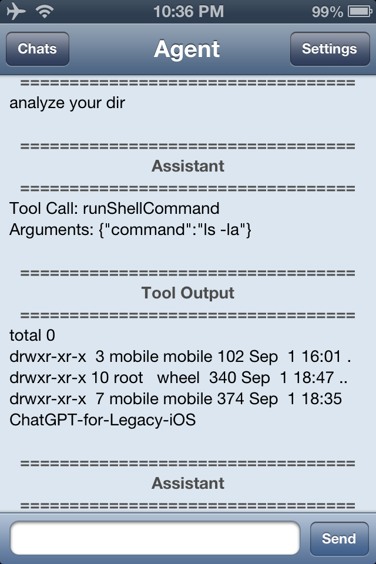

# Agentic

An AI chat client and **coding agent** for jailbroken iOS 6 devices (iPhone 4S primary target).
It talks to Google Gemini and lets the model read, write and edit files and run build tools
(`make`, `clang`, `ldid`, `dpkg-deb`, ...) inside a sandboxed workspace, so you can develop
Theos projects from the phone itself.



## Build

On a machine or device with [Theos](https://theos.dev) and the iOS 6.1 SDK, from the repo root:

```sh
make package FINALPACKAGE=1
```

The `.deb` lands in `packages/`. Install it on the device. The bundle id is unchanged, so
existing chats and settings are kept when you upgrade.

## Repository layout

| Path | What lives there |
|---|---|
| `Sources/App` | `main.m`, app delegate |
| `Sources/API` | Gemini client and agent loop, request/context builder, provider profiles, HTTPS client (libcurl) |
| `Sources/Agent` | Tools the model can call, shell runner, guardrails, path jail |
| `Sources/Model` | `AGMessage`, `AGConversation` (Foundation only) |
| `Sources/Storage` | Chat history on disk |
| `Sources/UI` | Screens and the message renderer |
| `Sources/Support` | Crash/debug logger |
| `Resources` | `Info.plist`, icons, images, `cacert.pem` (CA bundle for HTTPS verification) |
| `Vendor/curl` | Prebuilt libcurl 7.33 / OpenSSL 1.0.2 / zlib and headers |
| `Tools/legacy-cli` | The original standalone Python agent (kept for reference, see its README) |
| `Tests` | Host-side tests for the agent core (run on a Linux/macOS dev machine, see `Tests/README.md`) |
| `Docs` | Manual, security model, changelog, on-device test checklist |

All classes use one prefix, `AG`.

## What it does

- **Agent mode**: tools `runShellCommand`, `readFile`, `writeFile`, `editFile`.
- **Pure chat mode**: plain conversation, no tools.
- **Token Saver**: keeps requests small without losing the task (see `Docs/CHANGELOG.md`).
- **Provider profiles**: several Gemini keys or models, switchable.
- Terminal theme, markdown rendering, local chat history.

There is no streaming: replies arrive when the model has finished.

## Security in one paragraph

Commands never go through `/bin/sh`. A whitelist, a symlink-aware path jail, per-tool flag
checks, timeouts and output caps apply, and HTTPS certificates are verified. Read
`Docs/SECURITY.md` for what this does and does **not** protect against (`make` and the
compilers can still run arbitrary code through a Makefile).

## Credits

Original app by [BagXML](https://github.com/BagXML); intermediate fork by Li Xiang.
